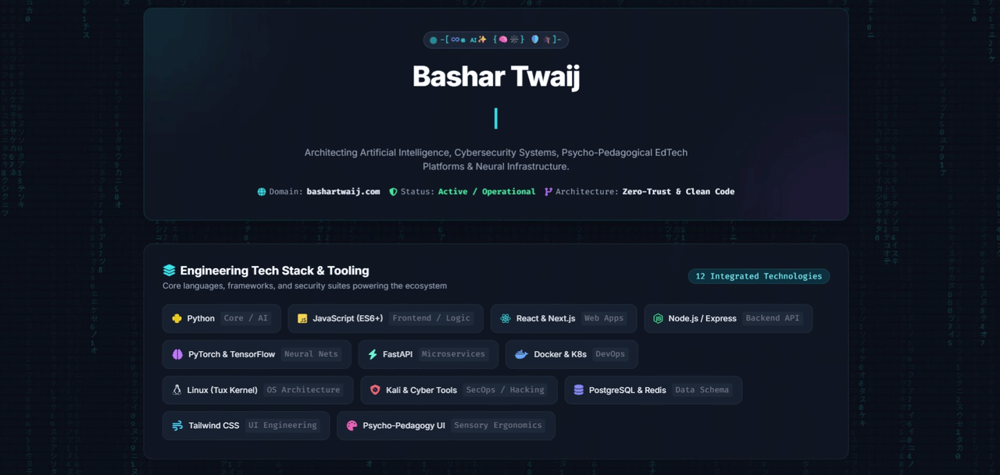

  

  

<picture>
  <source media="(prefers-color-scheme: light)" srcset="https://www.gitskins.com/api/section/wordmark?username=1stanunnaki&theme=aurora&avatar=https%3A%2F%2Favatars.githubusercontent.com%2Fu%2F4013617%3Fv%3D4&label=ANUNNAKI&v=cinematic-hero-wordmark-1&mode=light" />
  
</picture>

# 🐲 𝕭𝖆𝖘𝖍𝖆𝖗 𝕿𝖜𝖆𝖎𝖏  -[♾️֎ 🇦🇮✨ {🧠🕸️} 🛡️🎓]-
### AI Engineer & Vibe Coder | Cybersecurity & EdTech Architect

  
<!-- بطاقة عرض الداشبورد التفاعلية -->

### 🛠️ Engineering Tech Stack & Tooling
<!-- Engineering Tech Stack & Tooling -->

  
Core languages, frameworks, and security suites powering the ecosystem

  

    <!-- Python -->
    
    <!-- JavaScript -->
    
    <!-- React & Next.js -->
    
    <!-- Node.js / Express -->
    
  

  

    <!-- PyTorch & TensorFlow -->
    
    <!-- FastAPI -->
    
    <!-- Docker & K8s -->
    
  

  

    <!-- Linux -->
    
    <!-- Kali & Cyber Tools -->
    
    <!-- PostgreSQL & Redis -->
    
  

  

    <!-- Tailwind CSS -->
    
    <!-- Psycho-Pedagogy UI -->
    
  

-----

## 📊 `> ./stats --player=1stanunnaki`

---

## 🏆 `> unlock --achievements`

-----
### 🐉 Dragon Activity (Contribution Grid)

<picture>
  <source media="(prefers-color-scheme: dark)" srcset="https://raw.githubusercontent.com/BTAG-IQ/BTAG-IQ/output/github-contribution-grid-snake-dark.svg">
  <source media="(prefers-color-scheme: light)" srcset="https://raw.githubusercontent.com/BTAG-IQ/BTAG-IQ/output/github-contribution-grid-snake.svg">
  
</picture>

---
<h1 align="center">ANUNNAKI</h1>

Frontend or full-stack engineer

  

<b>4</b> public repositories, <b>1</b> stars, <b>22</b> contributions in the last year, a longest streak of <b>1</b> days and <b>13</b> followers.

----
### 🌐 links 

| Section / Site | Description | Direct Link |
| :--- | :--- | :---: |
| **Main Website** | Official Hub & Profile | [bashartwaij.com](https://bashartwaij.com) |
| **Majlis** | AI Community & Discussion Platform | [majlis.bashartwaij.com](https://majlis.bashartwaij.com) |
| **Projects** | AI Models, Tools & Repositories | [bashartwaij.com/projects](https://bashartwaij.com/projects) |
| **Courses** | Interactive EdTech & Training | [bashartwaij.com/courses](https://bashartwaij.com/courses) |
| **Blog** | Technical Articles & Cyber Insights | [bashartwaij.com/blog](https://bashartwaij.com/blog) |

---

---

### 🕹️ Interactive Features Notice
> **Note:** To play **Tic-Tac-Toe vs AI**, control the **Cyber Dragon Canvas**, or use the **Interactive CLI Shell**, please click the **[Launch Interactive Dashboard](https://btag-iq.github.io/BTAG-IQ/)** banner above!

