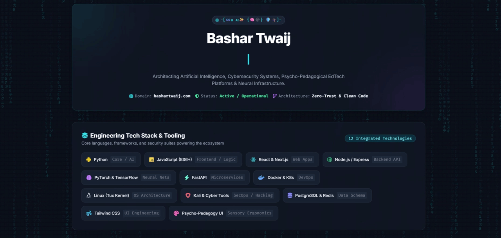

  <!-- Interactive Dashboard Live Banner -->
  
   

  <!-- Animated Terminal ASCII Wordmark (Clean Local SVG) -->
  
   

  <h1>🐉𝕭𝖆𝖘𝖍𝖆𝖗 𝕿𝖜𝖆𝖎𝖏 | 𒁀𒊺𒀀𒊒</h1>
  <h3>AI Engineer &amp; Vibe Coder · Cybersecurity &amp; EdTech Architect · Full-Stack Systems Builder</h3>

  

    
    
    
    
  

  <!-- Direct Social & Developer Platforms (Skill Icons + Branded Badges) -->
  

    &nbsp;&nbsp;
    &nbsp;&nbsp;
    &nbsp;&nbsp;
    &nbsp;&nbsp;
    
  

  

    
    
    
    
    
  

---

## 🃏 `> ./collector-card --edition=2026 --holo`

  

---

## 🛠️ `> ./stack --icons=skillicons.dev --theme=dark`

  
<b>⚡ Core Languages, Full-Stack &amp; Backend Frameworks</b>

  

    
  

  
<b>🧠 AI / Deep Learning, Databases &amp; Data Engines</b>

  

    
  

  
<b>☁️ Cloud Infrastructure, SecOps, DevOps &amp; Linux Kernel</b>

  

    
  

  
<b>💻 IDEs, Developer Workstations &amp; Community Platforms</b>

  

    
  

   

  

    
    
    
  

  

    
    
    
  

---

## 📊 `> ./stats --player=1stanunnaki`

---

## 🏆 `> unlock --achievements`

---

## 🏙️ `> ./activity --city --dragon-grid`

  

 

<picture>
  <source media="(prefers-color-scheme: dark)" srcset="https://raw.githubusercontent.com/1stANUNNAKI/1stANUNNAKI/output/github-contribution-grid-snake-dark.svg">
  <source media="(prefers-color-scheme: light)" srcset="https://raw.githubusercontent.com/1stANUNNAKI/1stANUNNAKI/output/github-contribution-grid-snake.svg">
  
</picture>

---

<h1 align="center">𝕭𝖆𝖘𝖍𝖆𝖗 𝕿𝖜𝖆𝖎𝖏 | 𒁀𒊺𒀀𒊒</h1>

AI &amp; Cybersecurity Architect · Full-Stack &amp; EdTech Systems Engineer

  

<b>24</b> public repositories, <b>24</b> stars, <b>4559</b> contributions in the last year, a longest streak of <b>15</b> days and <b>49</b> followers.

---

### 🌐 Ecosystem &amp; Social Directory

| Platform / Hub | Role &amp; Focus | Direct Access |
| :--- | :--- | :---: |
| 🌐 **Main Website** | Official Hub, Portfolio &amp; Digital Ecosystem | [bashartwaij.com](https://bashartwaij.com) |
| 🏛️ **Majlis Council** | Multi-Agent AI Council &amp; Community Platform | [majlis.bashartwaij.com](https://majlis.bashartwaij.com) |
| 🛡️ **GNT Online** | Autonomous Network Shield &amp; Cyber Telemetry | [gnt.bashartwaij.com](https://gnt.bashartwaij.com) |
| 🎮 **Interactive Dashboard** | Live Cyber Dragon Canvas, CLI Shell &amp; AI Games | [1stanunnaki.github.io/1stANUNNAKI](https://1stanunnaki.github.io/1stANUNNAKI/) |
| 💼 **LinkedIn** | Professional Network &amp; Engineering Updates | [linkedin.com/in/bashar-twaij](https://www.linkedin.com/in/bashar-twaij/) |
| 📸 **Instagram** | `𝕭𝖆𝖘𝖍𝖆𝖗 𝕿𝖜𝖆𝖎𝖏 \| 𒁀𒊺𒀀𒊒` (`@bashartwaij`) | [instagram.com/bashartwaij](https://www.instagram.com/bashartwaij/) |
| ✈️ **Telegram** | Direct Channel &amp; Collaboration (`@bashartwaij`) | [t.me/bashartwaij](https://t.me/bashartwaij) |
| 🚀 **Projects Hub** | Open-Source AI Models, Security Tools &amp; Web Apps | [bashartwaij.com/projects](https://bashartwaij.com/projects) |
| 🎓 **EdTech Courses** | Interactive Engineering &amp; Cybersecurity Training | [bashartwaij.com/courses](https://bashartwaij.com/courses) |
| ✍️ **Tech &amp; Dev.to Blog** | Deep-Dive Articles &amp; Cyber Architecture Insights | [bashartwaij.com/blog](https://bashartwaij.com/blog) |

---

### 🕹️ Interactive Features Notice
> **Note:** To play **Tic-Tac-Toe vs AI**, control the **Cyber Dragon Canvas**, or use the **Interactive CLI Shell**, click the **[Launch Interactive Dashboard](https://1stanunnaki.github.io/1stANUNNAKI/)** banner at the top of this profile!
